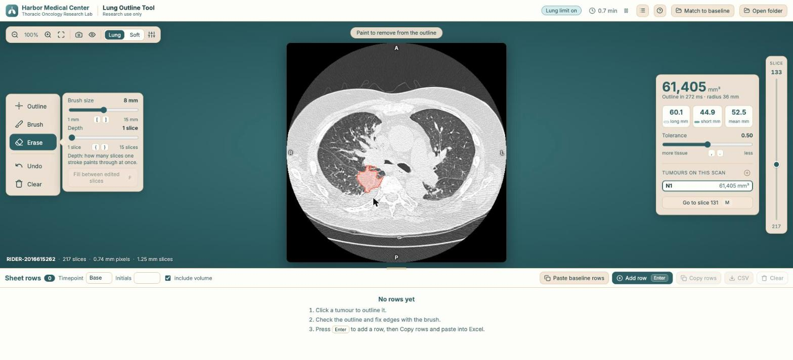
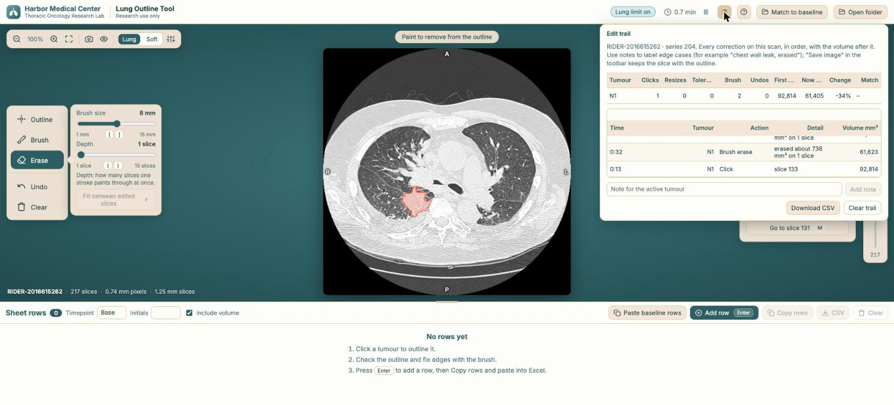

# Lung Outline Tool: results

Research use only. Not a medical device; no clinical claims. Practice data: TCIA RIDER Lung CT and RIDER-LungCT-Seg (CC BY). Last updated 19 Nov 2026.

- **Tool:** https://omerviner.github.io/lung-outline-tool/ (runs in the browser; scans never leave the machine)
- **Source and run instructions:** https://github.com/omerviner/lung-outline-tool (`npm install && npm run dev`; see the README)
- **Presentation:** a 15-slide deck of this material is available on request

## Summary
The lab (Thoracic Oncology Research Lab, Harbor Medical Center; the contacts are AI-simulated) asked for a tool that cuts the manual time of outlining and measuring lung tumours on CT. I built a browser tool: click a tumour, get an editable 3D outline with live volume and diameters, one sheet row in the lab's own format, a follow-up matching aid, and an edit trail that records every correction. Finding tumours is deliberately left to the researcher.

What the evidence supports, and how strongly:

| Claim | Basis | Status |
|---|---|---|
| Click outlines overlap the expert outline: median Dice 0.74, 63% of clicks at 0.7 or above, none empty | 145 simulated clicks on 15 held-out patients, scored against expert outlines | **Measured** |
| The proposed follow-up place hit the expert tumour in 28 of 28 same-day pairs; outline Dice 0.77 | 28 held-out pair directions | **Measured** (same-day scans only) |
| About 43% less time on a baseline scan, 49% on a follow-up | Model built from the lab's own time estimates | **Modelled** |
| About 50% less on baseline scans (15-20 min against 30-40), about 40% or more on follow-ups (15 against 25+); 10 of 15 matches needed no edit | 20 baseline scans (32 tumours) and 10 follow-ups (15 matches) reported by the lab contact | **Stated by a simulated contact**, not stopwatch-measured; no logs exported |
| About 1 click in 6 leaks into the chest wall, mediastinum or vessels; small nodules and hazy edges are weak | Same held-out clicks | **Measured**, and the main weakness |

## The problem and the choice made
For each scan, a researcher scrolls 250 to 400 slices twice to find tumours, measures them with a ruler tool, outlines about 1 in 5 for volume (15-25 min each), types a row into the sheet, and on follow-ups spends about 10 min matching each tumour to the previous scan. I asked the lab what they wanted. They declined automatic finding (a miss costs more than an extra mark; they keep their own double pass) and asked for: **click a tumour, get a 3D outline, drag to resize, a brush for hazy edges, live volume and diameters, one sheet row per tumour, and help on follow-ups.** That is what was built.

## What was built
- **Click-to-outline.** Click a tumour; the 3D outline, volume (mm³) and long, short and mean diameter appear at once. Drag outward or inward to resize (preview while dragging, exact when you stop), tolerance slider for hazy edges, brush and eraser through up to 15 slices, undo, several tumours per scan saved in the browser.
- **Fill between.** Fix a few slices with the brush, then interpolate the slices between them.
- **Sheet row.** One row per tumour in the lab's 18 columns and wording (Baseline / Follow-up timepoints, lobe and type drop-downs, volume in mm³, dates YYYY-MM-DD, slice from 1). Copy rows pastes into Excel; CSV download. Patient, date, series, thickness and slice come from the DICOM header, and Minutes from an active-time clock.
- **Follow-up matching.** "Match to baseline": from a baseline scan's saved outline, propose the tumour on the open follow-up (lung registration, then a local image match), flagged Confident or Uncertain. "Paste baseline rows" lets the follow-up inherit nodule ID, lobe, type and the next timepoint from the lab's own sheet.
- **Edit trail.** Every correction (click, drag resize, tolerance, brush add or erase, undo, clear, fill, match proposal, row) is logged per scan with active time and the volume after it; per-tumour summary, notes for edge cases, a Save image button and CSV export.
- **Time log.** Active-time clock with pause and a per-scan log (finding, outline and rows, total, by-hand model) with CSV export.
- **Lung model in the browser.** LungMask R231 (Apache-2.0) via ONNX Runtime Web keeps outlines inside the lung: about 30 s per scan with WebGPU, about 3 min on a CPU (every third slice; the mask keeps Dice 0.99 against all slices). Outlines work while it runs.

## Results: outline quality (measured)
Against the expert outlines: 59 scans, 31 patients, 295 simulated clicks (five per scan), split by patient: tuned on 16 patients, scored on the other 15 (145 clicks).

| | median Dice | clicks at Dice 0.7 or above | at 0.5 or above | empty | leaks (over 2x volume) | median volume error |
|---|---|---|---|---|---|---|
| First version (best single setting) | 0.59 | 43% | 55% | 3% | 33% | 58% |
| **Click-to-outline v2 (what the app runs)** | **0.74** | **63%** | **85%** | **0%** | **16%** | **22%** |
| Ceiling: best of 24 settings per click, picked with the expert outline | 0.78 | 68% | 93% | | | |

By tumour size (held-out median Dice): under 2 mL 0.73, 2-10 mL 0.74, 10-40 mL 0.67, over 40 mL 0.88. For reference, same-day repeat scans of one tumour differ by about 9.5% in volume on average (up to 33%) and about 3 mm in long axis. Some optimism is possible: held-out numbers were visible while tuning. Speed: drag preview about 11 ms median, exact outline 0.4 to 0.6 s.

## Results: follow-up matching (measured, same-day pairs)
On the 28 same-day test-retest pairs scored in both directions (56 pair-directions; held-out half = 28):

| | seed lands inside the expert outline | median distance to the expert centre | median Dice of the resulting outline |
|---|---|---|---|
| Same slice index | 43% | 15.3 mm | 0.28 |
| Same patient-space position (DICOM geometry) | 29% | 23.1 mm | 0.00 |
| **Lung registration + local image match (what the app runs)** | **100% (28 of 28)** | **1.5 mm** | **0.77** |

The result survives shifts up to 80 mm and rotations up to 15 degrees of the follow-up scan. 26 of 28 proposals were Confident (all hits); two were Uncertain, also hits. Matching is no longer the weak step; the outlining is (the same Dice 0.77 starting from the expert's own centre). The two scans of a pair are minutes apart, so this says nothing about months-apart growth or different breathing.

## What fails or is weak
- **About 1 click in 6 leaks** (over 2x the expert volume): small nodules beside vessels, tumours against the chest wall, spine or mediastinum. An inward drag or the brush fixes it, at a cost in time. 15% of held-out clicks are still below Dice 0.5.
- **Small nodules under 2 mL** are worse than in the first version (median Dice 0.73 against 0.79); one in three needs a fix.
- **Hazy, ground-glass or spiculated edges** are under-outlined (the solid part, not the rim); a lower tolerance usually recovers them.
- **Leak fixes were tried and mostly failed.** A chest-wall exclusion did not reduce leaks without losing tumours that touch the pleura or mediastinum. A size-aware grow-back raised held-out small-nodule Dice from 0.73 to 0.78 but lowered 10-40 mL tumours (0.67 to 0.63), and the gain rests on few patients, so v2 stays the default.
- **Matches often need an edit** (as reported by the lab contact): of 15 proposals, 10 were right as they were, 4 needed minor edge adjustment and 1 a re-click. One Confident proposal in the scored pairs was wrong, on a scan whose expert outline does not match the CT.
- **No automatic finding.** Tested (lung mask plus blob finder found 32 of 59 expert tumours, weak under 2 mL and over 40 mL), declined by the lab, left out.
- **Fill between is lightly tested.** In research code, outlining every 3rd slice and interpolating the rest kept Dice 0.94 against the expert outline and skipped about 63% of slice edits (slice counts, not measured times, with perfect expert key slices). In the app it was tried once by hand. A fill across a big gap replaces the real shape, so the key slices must be where the shape changes.
- **The CPU path is slow** (about 3 min per scan, twice for matching); WebAssembly multi-threading hung in the browser worker, so it is single-threaded. WebGPU gives about 30 s.
- **Axes** come from the 3D outline and are approximate, not clinical (RECIST) measurements.
- **Coverage:** only RIDER lung CT (thin slices, one expert outline per scan) was tested; other scanners, protocols and tumour types, thick-slice series, Firefox and Safari are untested.

### Example of a manual fix (developer run, not the lab's)
Practice scan RIDER-2016615262, a chest-wall case from the failure list. The first click gave 92,814 mm³ running along the chest wall (before the lung limit was ready); the lung limit plus two brush erases brought it to 61,405 mm³, and the edit trail logged each step with the volume after it. One case; it does not show how often this happens.

| After the brush | The edit trail |
|---|---|
|  |  |

(First click: `examples/example_1_first_click.jpg`.)

## Time saved
**By-hand baseline (the lab's own estimates, 17 Nov):** finding 10-20 min per scan; measuring 2-4 min per tumour; typing a row 3-5 min per tumour; full outline 15-25 min per tumour (done on about 1 in 5); matching about 10 min per follow-up. Typical scan: 1-3 tumours (modelled as 2).

**Model (not measured on the lab):**

| Scan with 2 tumours | Today (min) | With the tool (min) |
|---|---|---|
| Finding | 15 | 15 (unchanged) |
| Measuring axes | 6 | 0 (from the outline) |
| Typing rows | 8 | 1 |
| Outlines for volume (0.4 per scan today, every tumour with the tool) | 8 | 5 |
| **Baseline scan** | **37** | **21** (43% less) |
| Matching on a follow-up | 10 | 3 |
| **Follow-up scan** | **47** | **24** (49% less) |

Finding is unchanged, so about half is the ceiling; "40 to 10 minutes" is not reachable. The with-tool numbers (2.5 min to click, check and edit one tumour; 3 min to confirm a match) are assumptions, and the lab contact may count typing inside measuring, which lowers the saving by a few minutes. The tool also gives a volume for every tumour, not only 1 in 5; the model counts that as extra value, not time saved.

**Reported runs (lab contact, 18 Nov 2026).** The contact is an AI-simulated persona, so these are stated times and counts, not measured ones; no CSV logs have been exported. Sample: 20 baseline scans (32 tumours) and 10 follow-up scans (15 matches) on the practice set.

| | His usual by-hand time | With the tool (his report) | Saving | Model |
|---|---|---|---|---|
| Baseline scan, full outlines | 30-40 min | 15-20 min | about 50% (33-63% across the ranges) | 37 to 21 min, 43% |
| Follow-up scan | 25+ min | about 15 min | about 40% or more | 47 to 24 min, 49% |

Match to baseline, 15 proposals: **10 right as they were (67%), 4 right place needing minor edge adjustment (27%), 1 needed a re-click (7%)**; the right tumour was found in 14 of 15. For spiculated or hazy edges the brush was essential and added about 2-3 minutes of touch-up per such tumour, still faster than drawing from scratch (his words). Volumes felt more consistent (an impression; no agreement figure). No freezes or crashes. The savings are in the same range as the model. His by-hand follow-up time (25+ min) is well below the model's 47 min, probably because he counts a narrower task, and his baseline range comes from full outlines, which the model assumed for only 0.4 tumours per scan. The counts are small, self-reported and from one persona.

**Planned measured trials (still wanted).** On a lab machine, with the in-app time log (active minutes: finding, outline and rows, total; CSV) and the edit trail (CSV, notes, images), per tumour and per follow-up: minutes with the tool against his by-hand minutes; whether outlines and matches were accepted, edited or redone, and how often a Confident proposal was wrong; and the tool's axes and volume against his ruler and freehand outline on the same tumours, compared with the reference that same-day repeats differ by about 3 mm and 9.5%. Report medians and ranges, use different scans for the by-hand and tool timings, and state the sample size. Until then every time-saved figure is labelled modelled or stated.

## Limits of this evaluation
- The lab contacts are AI-simulated. The baseline timings and the reported runs are what they said, not a stopwatch, and are not an independent assessment of the tool.
- The practice set has one outlined tumour per scan, and the expert outlines are the only truth available; simulated clicks stand in for a person.
- Held-out tests were split by patient, with some optimism possible. The outline and matching scores were checked with independent code (Python recomputes Dice and hit rate from the saved masks).
- Not a medical device; research use only.

## Quality review before submission
The app had a separate code and design review (`research/reports/opus_review_report.md`): about 20 fixes, each its own commit. Examples: a stale worker result could silently drop the next click; a failed worker or bad folder left the page waiting; shortcuts fired behind open dialogs; matched outlines lost their match note after a reload; pasted-row dates in common formats did not match; tables and the header clipped text at narrow widths; focus rings and button names for keyboard and screen-reader use. Known and left: the undo history holds up to six full copies of the mask (memory on large scans), CSV cells starting with "=" are not escaped, and undo does not roll back the Fill-between slice list. Not tested: the CPU path after the fixes, thick-slice and corrupt folders, storage quota, and Paste baseline rows end to end.

## What I would do next
1. Measured logs from the lab runs; check months-apart follow-ups; fix what they report.
2. Test Fill between on real hard cases; revisit the size-aware grow-back on a larger set of small nodules.
3. Re-score matching on any months-apart pair available; add a side-by-side baseline view.
4. A faster CPU path (quantised model) or require WebGPU.

## Where things are
App source in `src/`, algorithms in `src/core/`. Reports in `research/reports/`: `opus_report.md` (outline method and scores), `opus_outline_b_report.md` (leak fixes and interpolation), `opus_match_report.md` (matching), `time_saved_tracker.md` (time model and trial protocol), `client_side_test.md` (browser model test), `opus_review_report.md` (code and design review). Result tables and scoring scripts are in `research/results/` and `research/scripts/` (they need the TCIA data, which is not included). Screenshots are in `docs/examples/` and `docs/screenshots/`.
